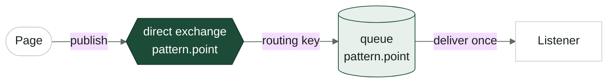
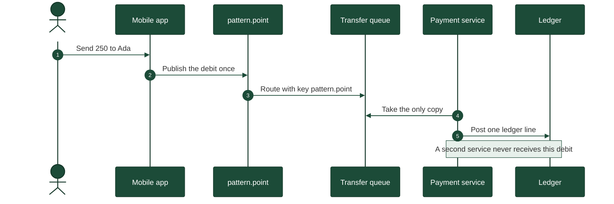
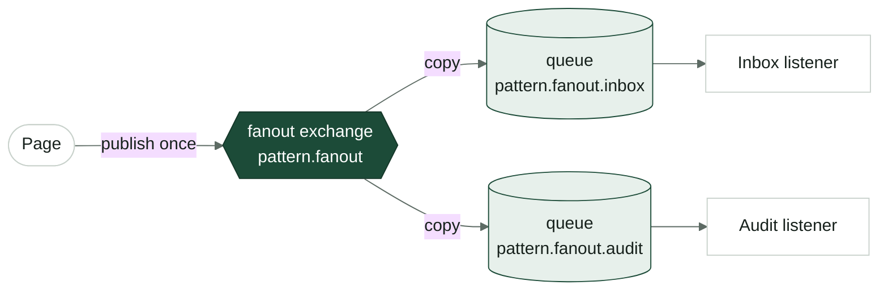
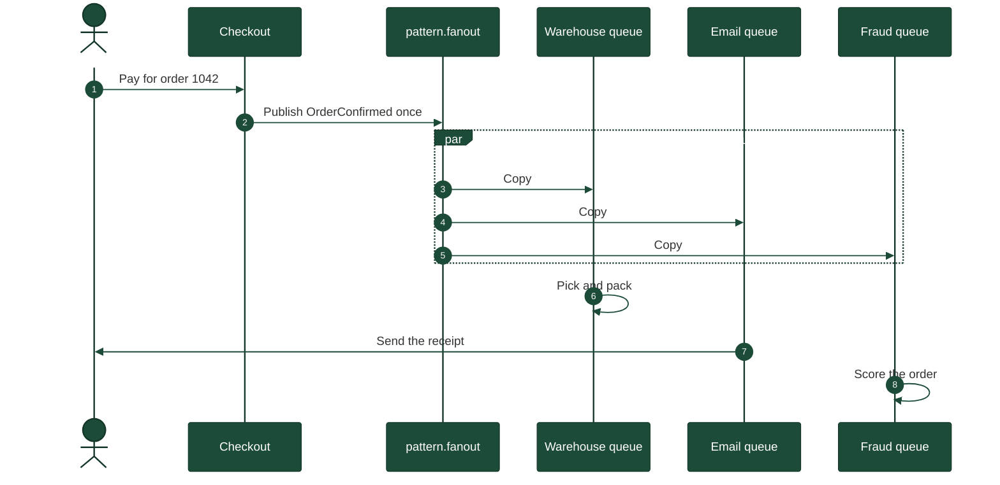
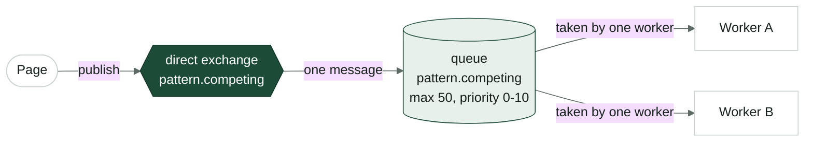
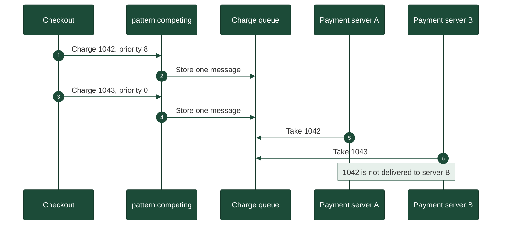
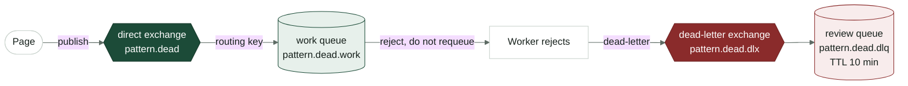
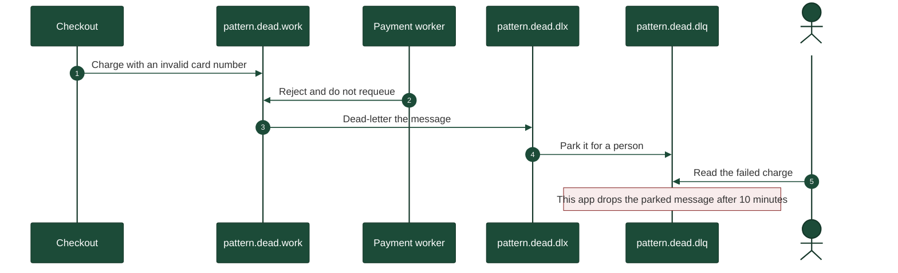

# simple-rabbitmq-and-springboot-project

Four small RabbitMQ examples in one Spring Boot app. Each example is a package, a pair of broker objects, and a card on the page.

## What you need

RabbitMQ is already running in Docker. This repo does not start it.

| | |
|---|---|
| Image | `rabbitmq:4-management-alpine` |
| AMQP | `localhost:5672` |
| Management UI | http://localhost:15672 |
| Virtual host | `/` |
| User | `egitim` |

Java 17 and Maven. The broker password stays in `src/main/resources/application.yml`, which git ignores. Copy `application.yml.example` and fill the password there.

## Run

```bash
mvn spring-boot:run
```

Open http://localhost:8080. The info mark on a card explains that pattern. The same calls work with curl. Send `{"text":"hello"}`.

Lists on the page live in memory. Restarting the app clears them. The queues stay in RabbitMQ until you delete them.

`RabbitTemplate` publishes. A `@RabbitListener` consumes. `RabbitConfig` turns the Java record into JSON on the wire.

## The four patterns

**Point to point** — `com.simplemq.pattern.pointtopoint`

One direct exchange, one queue, one listener. The name of all three is `pattern.point`. A message is delivered once.



A bank transfer is the shape of this pattern. The mobile app publishes one debit. The exchange routes it to a single queue. One payment service takes it and posts the ledger line. A second service never sees that debit, so the customer is not charged twice.



```bash
curl -X POST http://localhost:8080/api/patterns/point-to-point \
  -H 'Content-Type: application/json' -d '{"text":"hello"}'
curl http://localhost:8080/api/patterns/point-to-point
```

The queue is durable and each message expires after 60 seconds if nobody takes it. The listener in this app is fast, so you only see that expiry when the listener is stopped.

Where it shows up:

1. A bank transfer is handed to one payment service. A second copy would charge the customer twice.
2. A courier app assigns one delivery to one driver. The same parcel is not offered to every driver at once.
3. An airline check-in kiosk sends a boarding pass job to one printer queue.
4. A hospital lab sends one blood sample order to the analyser that is free to run it.
5. A payroll run sends each employee's payslip to one generator, then the PDF is stored once.

**Publish and subscribe** — `com.simplemq.pattern.publishsubscribe`

A fanout exchange, `pattern.fanout`, copies one publish onto `pattern.fanout.inbox` and `pattern.fanout.audit`. Both cards show the same text. The routing key is ignored.



An order confirmation is the shape of this pattern. Checkout publishes one event. The exchange copies it onto every bound queue. Warehouse, email, and fraud each work from their own copy. One of them finishing does not remove the others.



```bash
curl -X POST http://localhost:8080/api/patterns/publish-subscribe \
  -H 'Content-Type: application/json' -d '{"text":"hello"}'
curl http://localhost:8080/api/patterns/publish-subscribe/inbox
curl http://localhost:8080/api/patterns/publish-subscribe/audit
```

Where it shows up:

1. A shop confirms an order once. Warehouse, email, and fraud check each get their own copy.
2. A news app publishes a breaking alert. Push, the site banner, and the archive each subscribe.
3. A ride arrives. The rider's phone, the driver's phone, and the trip log all hear the same event.
4. A bank posts a card payment. The customer notification, the ledger, and the spending-insights service each keep a copy.
5. A factory sensor crosses a limit. The control room, the maintenance ticket system, and the daily report each receive it.

**Competing consumers** — `com.simplemq.pattern.competing`

One direct exchange and one queue, both named `pattern.competing`. Two listeners read that queue. Each message is handed to only one of them. Send a few and compare Worker A with Worker B.



A checkout desk is the shape of this pattern. Charges wait on one queue. Whichever payment server is free takes the next charge. Server A and server B never both settle the same card payment. A higher priority, such as a retry, is delivered first when the queue is backed up.



```bash
curl -X POST http://localhost:8080/api/patterns/competing \
  -H 'Content-Type: application/json' -d '{"text":"job-1","priority":8}'
curl http://localhost:8080/api/patterns/competing/worker-a
curl http://localhost:8080/api/patterns/competing/worker-b
```

The queue holds at most 50 messages. Past that, the oldest is dropped. Priority runs from 0 to 10. A higher number is delivered first when messages are waiting. The page has a priority field; leaving it empty sends 0. The list shows the priority next to the text, for example `job-1 · p8`.

Where it shows up:

1. Several checkout servers share one payment queue. Each charge is taken by whichever server is free.
2. A photo app has many resize workers. Each uploaded picture is processed by one of them.
3. A call centre puts incoming chats on one queue. The next free agent takes the next chat.
4. A tax office runs several machines over the same filing queue at the deadline. Each return is processed once.
5. A map service splits route calculations across a pool of workers. One journey is not calculated twice.

**Dead letter** — `com.simplemq.pattern.deadletter`

The worker on `pattern.dead.work` rejects every message and does not put it back. The queue is declared with a dead-letter exchange, so the broker moves the message to `pattern.dead.dlq`.



A malformed card payment is the shape of this pattern. The live worker refuses the message. The broker does not put it back on the work queue, where it would block the next valid charge. It moves the message through the dead-letter exchange onto a review queue. Support fixes the card number, then publishes a new message. The parked copy expires after 10 minutes in this app.



```bash
curl -X POST http://localhost:8080/api/patterns/dead-letter \
  -H 'Content-Type: application/json' -d '{"text":"cannot-handle"}'
curl http://localhost:8080/api/patterns/dead-letter
```

A message on the dead-letter queue expires after 10 minutes.

Where it shows up:

1. A card payment is rejected because the card number is malformed. It leaves the live queue and waits for a person to look at it.
2. An insurance claim file is missing a required page. The claim is parked instead of blocking the queue behind it.
3. A shipping label service cannot read an address. The order sits aside until support fixes the address.
4. A payroll row names an employee who is not in the system. That row is set aside so the rest of the run continues.
5. A video upload fails transcoding three times. The file moves to a review queue instead of being retried forever.

## Queue arguments in this app

RabbitMQ stores these on the queue the first time it is declared. Changing them later means declaring a new queue, or deleting the old one first.

| Queue | Argument | Why it is here |
|---|---|---|
| `pattern.point` | durable, message TTL 60s | The queue survives a broker restart. An unread message does not sit forever. |
| `pattern.fanout.inbox`, `pattern.fanout.audit` | durable | Each subscriber keeps its own copy. |
| `pattern.competing` | durable, max length 50, drop oldest, max priority 10 | A work queue with two workers, a cap, and an order when it backs up. |
| `pattern.dead.work` | durable, dead-letter exchange and routing key | A rejected message has somewhere to go. |
| `pattern.dead.dlq` | durable, message TTL 10 min | The shelf for rejected messages empties itself. |

Two settings are left off on purpose. Single active consumer would let only one of the competing workers run, which is a different pattern. A quorum queue would replace the classic queues this app declares; the examples do not need a replicated queue.

In the management UI, open a queue and look at its arguments if you want to see the same values the code declared.
